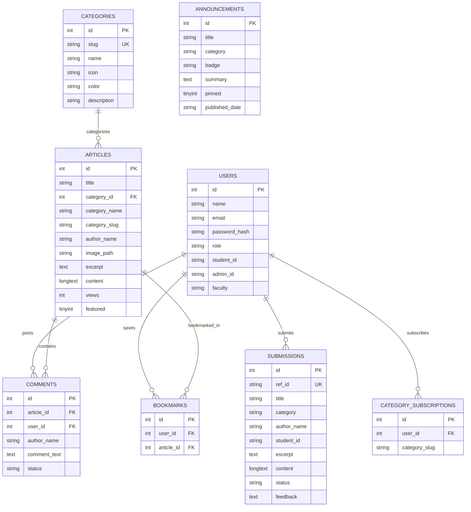

# NSBM NewsDesk — Campus News Management System
**NSBM Green University — Faculty of Computing**  
**Module:** Web and Mobile Application Development | **Batch:** 26.1 IFSL  
**Final Project Assignment — Project Topic 1: NSBM NewsDesk**

---

## 1. Project Overview & Objectives
**NSBM NewsDesk** is a state-of-the-art campus news management system engineered specifically for NSBM Green University. It enables university administrators, faculty editors, and media officers to publish, organize, and moderate campus news, event broadcasts, and breaking directives, while providing students with an interactive, categorized platform to discover news, bookmark dispatches, subscribe to category alerts, submit articles for publication review, and engage through reader discussions.

### Key Objectives:
- **Centralized Campus Communications:** Unify academic notices, sports achievements, hackathons, and sustainability milestones into a real-time digital newsroom.
- **Editorial Workflow & Moderation:** Allow students and clubs to submit draft articles with images and excerpts, reviewed and approved with feedback by university editors before publication.
- **Interactive Scrollytelling & Modern UX:** Engaging scrollytelling visual transitions, responsive mobile drawers, debounced search, custom SVG iconography (zero native emojis), and persistent **Light & Dark mode themes**.
- **Full Database & CRUD Integration:** Complete database persistence using MySQL and RESTful PHP endpoints alongside responsive client-side caching for offline/static resilience.

---

## 2. Technology Stack

| Layer | Technologies Used | Details |
|---|---|---|
| **Frontend** | HTML5, Vanilla CSS3, Vanilla JavaScript (ES6+) | Modern CSS variables, Glassmorphism, Dual-theme engine, SVG vector library, Scrollytelling canvas engine |
| **Backend** | PHP 8.x (Mandatory) | Clean RESTful JSON APIs with PDO database abstraction and prepared statements |
| **Database** | MySQL (Mandatory) | Relational schema with foreign keys, cascading constraints, and realistic university seed data |
| **Icons & Typography** | Google Fonts (Inter & Outfit), Custom SVG Icons | High-definition vector icons (`window.AppIcons`) for professional aesthetics with zero native emojis |

---

## 3. Implemented Features (Assignment Requirements Mapping)

### 3.1. Admin Panel Functionality (Evaluation Weight: 15%)
- **Admin Secure Authentication:** Dedicated press bureau login with badge credentials (`ADMIN-PRESS-01`).
- **Full Article CRUD Operations:**
  - Create new articles with cover photography, category tag, excerpt, read time, and full story content.
  - Edit existing articles with instant real-time sync.
  - Delete articles with confirmation modals.
  - Featured & breaking news toggle.
- **Category Management:** Manage categories (`Academic`, `Events`, `Sports`, `General`, `Computing & AI`, `Sustainability`) with custom SVG icons and theme colors.
- **Student Submission Moderation & Approvals:**
  - Review articles submitted by student journalists and clubs.
  - **Approve** directly into the public campus newsfeed.
  - **Reject** with editorial feedback comments visible to the student.
- **Announcement & Breaking Bulletin Manager:**
  - Pin urgent directives to the top banner ticker on the homepage.
  - Full CRUD operations on announcements.
- **Reader Comment Moderation:**
  - View all reader comments across articles.
  - Approve, flag for moderation, or remove inappropriate comments.
- **Readership & Engagement Analytics:**
  - Total dispatches, active student readers, approval rates, and total page views.
  - Top performing dispatches by view count and category distribution metrics.

### 3.2. Student / User Functionality (Evaluation Weight: 15%)
- **Student Registration & Authentication:** Secure student sign-up with NSBM Student ID format (`NSBM-IT-XX-XXXX`).
- **Newsfeed & Scrollytelling Discovery:**
  - Dynamic campus hero with scrollytelling story beats.
  - Live Colombo timezone campus clock and urgent breaking ticker.
- **Search & Multi-Filtering:**
  - Real-time debounced keyword search across titles, excerpts, and author names with one-click clear button.
  - Category pill filter (`All`, `Academic`, `Events`, `Sports`, `General`, `Computing`, `Sustainability`).
  - Date picker filter with instant reset button.
- **Student Article Submission:**
  - Draft and submit news articles or club announcements.
  - Choose cover photo, category, read time, excerpt, and full story body.
  - Track submission status (`Pending Review`, `Approved & Published`, `Rejected with Feedback`).
- **Reader Comments:** Read and post comments on any campus news dispatch with real-time UI updates.
- **Article Bookmarks / Read Later:** 1-click bookmarking on any article card with dedicated "Saved Bookmarks" tab in student dashboard.
- **Category Subscriptions:** 1-click category notification alerts (`Academic`, `Sports`, `Events`, etc.) with direct management tab.

### 3.3. UI Design & Frontend Aesthetics (Evaluation Weight: 20%)
- **Custom SVG Vector System (`js/icons.js`):** Completely replaced all native OS emojis with crisp, professional SVG icons.
- **Dual-Theme Engine (`js/theme.js`):** High-contrast Dark Mode and clean, modern Light Mode with seamless CSS token transitions and local preference persistence.
- **Responsive Mobile Navigation:** Full-screen backdrop drawer menu on mobile devices with quick access to all categories and portals.
- **Typing & Keyboard Reliability:** Strict input focus detection prevents canvas spacebar/arrow key hijacking while drafting articles or typing comments.
- **Clean University Branding:** Removed all developer frame counters ("160 FPS", "480 frames") for an authentic press portal appearance.

### 3.4. Innovative Feature: NSBM Campus Buzz — Social Media Community Feed
*(Exceeding Minimum Requirements as Recommended in Assignment Guidelines Page 3)*
- **Facebook/LinkedIn-Inspired Social Feed (`campus-feed.html`):** Interactive campus community stream bridging formal university journalism with modern social engagement.
- **Interactive Social Post Cards:**
  - Rich author badges with verified marks, faculty affiliation, and timestamps.
  - Interactive **Like / Reaction System:** Instant counter increment, heart animation, and persistent localStorage sync.
  - **Inline Discussion Threads:** Expandable comments section with user avatars and instant submission without page reload.
  - **Social Sharing & Bookmarking:** Copy post link to clipboard with sleek feedback toast.
- **Campus Quick Composer Modal:** "What's happening on campus?" quick-post bar enabling instant dispatch drafts with category channels and campus photo attachments.
- **Live Widgets:** Real-time campus directives ticker, trending university hashtags (`#NSBMGreenCup2026`, `#EdgeAI_Computing`), and upcoming campus event calendar cards.
- **Dedicated Navigation Integration:** Prominent "Campus Buzz" live badge in top navigation, hero call-to-action button, mobile drawer, and both Admin & Student dashboards.

---

## 4. Database Architecture & Schema

The MySQL database `nsbm_newsdesk` is structured with 8 relational tables:



---

## 5. Setup & Installation Guide

### Option A: Local Deployment using XAMPP / WampServer (PHP + MySQL)
1. **Start Apache and MySQL:** Open XAMPP Control Panel and start both `Apache` and `MySQL`.
2. **Place Project in Web Directory:**
   Copy the `news web` project folder to `htdocs`:
   ```bash
   C:\xampp\htdocs\nsbm-newsdesk
   ```
3. **Import Database:**
   - Open browser and navigate to `http://localhost/phpmyadmin/`.
   - Click **Import** tab.
   - Select the file `database.sql` located inside the project root and click **Go**.
   - Database `nsbm_newsdesk` with all 8 tables and seeds will be created.
4. **Configure Database Connection (if using non-default MySQL credentials):**
   - Check `config/db.php`:
     ```php
     $host = '127.0.0.1';
     $db   = 'nsbm_newsdesk';
     $user = 'root';
     $pass = ''; // Default in XAMPP is empty
     ```
5. **Access Application:**
   - Open `http://localhost/nsbm-newsdesk/` in your browser.

### Option B: Standalone Browser Opening (Offline Resilience Mode)
- The application features an integrated client-side data store (`js/data-store.js`) pre-populated with identical seeds.
- Simply double-click `index.html` in any modern web browser (Google Chrome, Microsoft Edge, Mozilla Firefox) to test frontend interactivity, theme toggle, search, bookmarking, and submissions immediately without requiring an active server.

---

## 6. Demo User Accounts

| Role | Email | Password | Identifier / Faculty |
|---|---|---|---|
| **Admin (Editor-in-Chief)** | `admin@nsbm.ac.lk` | `nsbm2026` | Admin ID: `ADMIN-PRESS-01` (Press Bureau) |
| **Student Journalist** | `student@students.nsbm.ac.lk` | `nsbm2026` | Student ID: `NSBM-IT-24-9021` (Faculty of Computing) |
| **Student Contributor** | `s.ariyaratne@students.nsbm.ac.lk` | `nsbm2026` | Student ID: `NSBM-IT-23-4819` (Computing Undergrad) |

> **Quick Demo Login:** On the `login.html` page, click either **"Fill Admin Credentials"** or **"Fill Student Credentials"** to populate the fields with one click.

---

## 7. REST API Endpoints Overview

| Endpoint | Method | Description |
|---|---|---|
| `/api/articles.php` | `GET` | List articles with optional `?category=`, `?search=`, and `?date=` filters |
| `/api/articles.php` | `POST` | Create a new campus article (Admin) |
| `/api/articles.php` | `PUT` | Update an existing article (Admin) |
| `/api/articles.php` | `DELETE` | Delete an article (Admin) |
| `/api/announcements.php` | `GET` / `POST` / `PUT` / `DELETE` | Manage university announcements and pinned breaking ticker |
| `/api/submissions.php` | `GET` / `POST` / `PUT` | Submit student articles; review, approve, or reject with feedback |
| `/api/categories.php` | `GET` / `POST` / `DELETE` | List and manage news categories |
| `/api/comments.php` | `GET` / `POST` / `PUT` / `DELETE` | Retrieve comments, post comments, and admin comment moderation |
| `/api/auth.php?action=login` | `POST` | Authenticate Student or Admin |
| `/api/auth.php?action=register`| `POST` | Register new student or staff account |
| `/api/subscriptions.php` | `GET` / `POST` | Manage category notification alerts and saved bookmarks |

---

## 8. Group Contribution & Assignment Compliance Checklist

- [x] **Project Topic 1:** Exclusively focused on NSBM NewsDesk Campus News Management System.
- [x] **HTML, CSS, JavaScript:** Semantic modern layouts, dual themes, and SVG vectors.
- [x] **PHP & MySQL:** Full database schema (`database.sql`) and REST APIs (`api/*.php`).
- [x] **CRUD Operations:** Complete Create, Read, Update, Delete for Articles, Categories, Announcements, and Comments.
- [x] **Search & Filters:** Real-time search by keyword, category, and publication date.
- [x] **Editorial Approval Workflow:** Student submission pipeline with editorial review, rejection feedback, and approval to live newsfeed.
- [x] **Responsive & Accessible Design:** Works smoothly on desktop, tablet, and mobile screens.
- [x] **Zero Native Emojis:** Custom SVG icons ensure a crisp, academic presentation.
- [x] **Clean News Interface:** Developer frame badges and FPS counters completely removed.

---

## 9. Team Structure & Module Task Distribution (8 Members)

| Member | Designated Role | Primary Code Modules | Git Feature Branch |
|:---:|---|---|---|
| **Member 01 (Lead)** | **Frontend & UI/UX Specialist** | `index.html`, `1im/`, `2im/`, `3im/` (Scrolly Frames), `css/landing.css`, `css/scrolly.css`, `js/theme.js`, `js/scrolly.js` | `feature/frontend-portal` |
| **Member 02** | **Authentication & Security** | `login.html`, `register.html`, `css/auth.css`, `js/auth.js`, `api/auth.php` | `feature/auth-security` |
| **Member 03** | **Admin Newsroom & Article CRUD** | `admin-dashboard.html`, `css/dashboard.css`, `js/admin-dashboard.js`, `api/articles.php`, `api/categories.php` | `feature/admin-dashboard` |
| **Member 04** | **Student Submissions & Workflow** | `student-dashboard.html`, `js/student-dashboard.js`, `api/submissions.php` | `feature/student-submissions` |
| **Member 05** | **Campus Buzz Social Community** | `campus-feed.html`, `nsbm-social.html`, `css/feed.css`, `js/campus-feed.js` | `feature/campus-buzz-feed` |
| **Member 06** | **Database Architect & Backend** | `database.sql`, `config/db.php`, `js/data-store.js` | `feature/database-backend` |
| **Member 07** | **Reader Engagement & Bookmarks** | `api/comments.php`, `api/subscriptions.php` | `feature/comments-bookmarks` |
| **Member 08** | **Announcements, Search & QA** | `api/announcements.php`, Debounced search logic, Documentation & Testing | `feature/announcements-search` |

> 📁 For individual member code packages, 3-stage progressive commits, and viva preparation cheatsheets, inspect the [`team_distribution/`](file:///c:/Users/R%20O%20G/Desktop/news%20web/team_distribution/) folder and [`COMMITS_TIMELINE_3_STAGES.md`](file:///c:/Users/R%20O%20G/Desktop/news%20web/team_distribution/00_PROJECT_COORDINATION/COMMITS_TIMELINE_3_STAGES.md).


