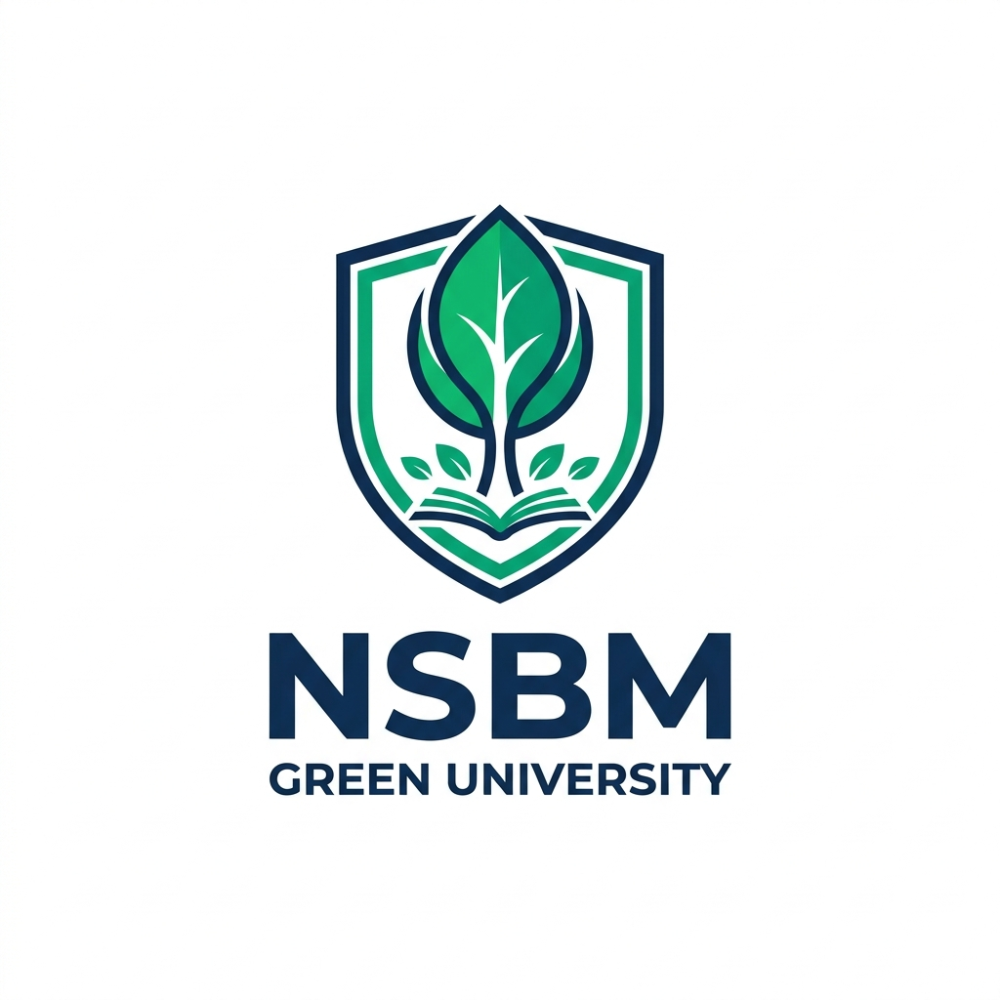

  
  <h1>🎓 NSBM Campus News & Social Platform</h1>
  
<em>A comprehensive and interactive portal developed for NSBM Green University undergraduates.</em>

 

  
  
  
  
  

## 🚀 About The Project
This platform is designed to connect students, share real-time university updates, and manage campus announcements efficiently in a modern, user-friendly interface. 

## ✨ Key Features
* 📰 **Campus News Feed:** Real-time updates and university announcements.
* 🔐 **Secure Authentication:** Student and Admin login systems.
* 👥 **Social Connectivity:** Connect with batchmates and share moments.
* ⚙️ **Admin Dashboard:** Centralized control for university staff.

## 👨‍💻 Team Members
This project was collaboratively developed by our team.
* **Frontend Lead:** Janith Dimuthu Vishwajith
* **Authentication & Security:** Member 02 *(You can update these names later)*
* **Admin Dashboard & CRUD:** Member 03
* **Student Submissions:** Member 04
* **Campus Buzz Social Feed:** Member 05
* **Database & Backend Core:** Member 06
* **Comments & Bookmarks:** Member 07
* **Announcements Search & API:** Member 08

---

  
Developed with ❤️ by NSBM Software Engineering Undergraduates

