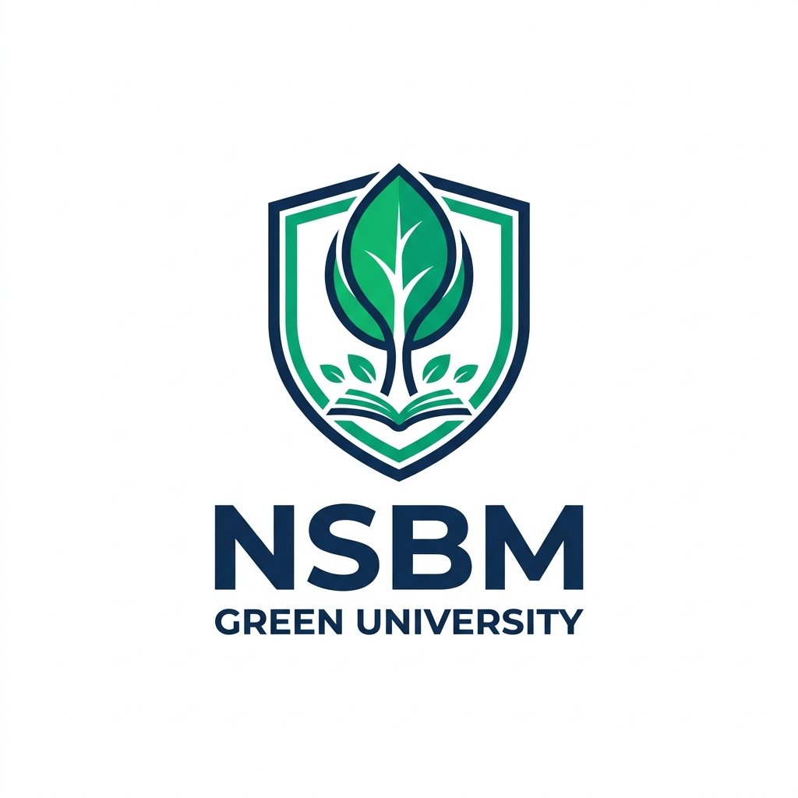

  
  <h1>🎓 NSBM Campus News & Social Platform</h1>
  
<em>A comprehensive and interactive portal developed for NSBM Green University undergraduates.</em>

 

  
  
  
  
  

## 🚀 About The Project
This platform is designed to connect students, share real-time university updates, and manage campus announcements efficiently in a modern, user-friendly interface. 

## ✨ Key Features
- 📰 **Campus News Feed:** Real-time updates and university announcements.
- 🔐 **Secure Authentication:** Student and Admin login systems.
- 👥 **Social Connectivity:** Connect with batchmates and share moments.
- ⚙️ **Admin Dashboard:** Centralized control for university staff.

## 👥 Team Members & Roles
This project was collaboratively developed by our team:

- **Member 01 (Frontend Lead & Architecture):** K.D.J.D. Vishwajith
- **Member 02 (Authentication & Security):** R.D.D.D. Karunarathna
- **Member 03 (Admin Dashboard & CRUD):** M.F.M. Faaiq
- **Member 04 (Student Submissions):** M.M.D.A. Akarsha
- **Member 05 (Campus Buzz & Social Feed):** K.P.N. Perera
- **Member 06 (Database & Backend Core):** A.A. Sooriyaarachchi
- **Member 07 (Comments & Bookmarks):** S.A. Wickramanyaka
- **Member 08 (Announcements, Search & Analytics):** H.A.S. Vimansha

---

  
Developed with ❤️ by <strong>Faculty of Computing (FOC) Undergraduates</strong>

  
<strong>NSBM Green University</strong>

